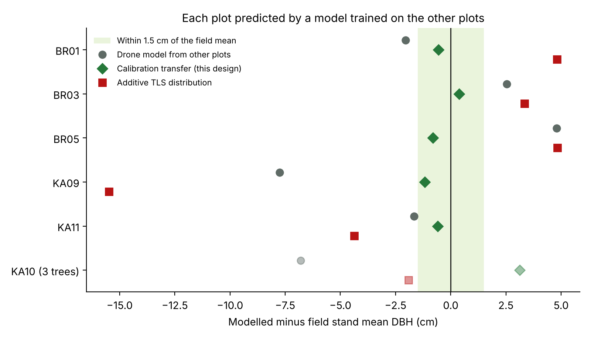

# Calibration transfer of drone LiDAR DBH models with a few TLS trees

**Showcase component** of an analysis of how forest inventory models transfer between terrestrial (TLS) and drone (ULS) LiDAR.
Author: Hammed Akano, Deakin University. Prepared November 2026.

This repository shares one component of the analysis, so that the reported results can be traced to working code.
The full pipeline (steps 00 to 24, covering tree detection, cross-platform tree pairing, stem fitting in the drone cloud, model comparison and coverage analysis) is not included here and is available from the author on request.

## The question

A drone sees tree crowns, not stems, so DBH has to be predicted from crown metrics. A model trained in one place is often biased in a new stand.
Can a model trained on other plots be moved to a new plot using only that plot's own TLS trees, without any tape measurements?

## Design

| Role | Source |
|---|---|
| Inputs | ULS leaf-on tree metrics: height, crown projection area, crown base height, position |
| Label | TLS DBH |
| Truth | Tape DBH, used only to score the result |
| Test | Leave one plot out. Each tape plot is predicted by a model trained on the other plots, then calibrated with its own TLS trees |

The model is a log-log allometry with two neighbourhood (competition) terms:

log(DBH) = b0 + b1 log(h) + b2 log(CPA) + b3 log(crown length) + b4 log(nearest neighbour distance) + b5 log(1 + Hegyi index)

The calibration fits this allometry as a mixed model with a random intercept and a random slope on log height for each plot.
The target plot enters the fit only through its TLS trees, so its correction is estimated from those trees and is pulled towards zero when they are few or noisy.

## Result

Mean ± SD of DBH (cm) for the tape trees of each unseen plot, with the deviation from the field (tape) mean. Layout after Finn et al. (2026).

| Plot | Tape trees | Field | Drone model from other plots | Calibration transfer | Additive TLS distribution |
|---|---|---|---|---|---|
| BR01 | 400 | 23.7 ± 15.3 | 21.6 ± 14.8 (−2.0) | 23.1 ± 15.0 (−0.5) | 28.5 ± 14.1 (+4.8) |
| BR03 | 80 | 32.9 ± 17.3 | 35.4 ± 17.4 (+2.5) | 33.3 ± 16.7 (+0.4) | 36.2 ± 14.1 (+3.3) |
| BR05 | 214 | 33.4 ± 18.8 | 38.2 ± 20.4 (+4.8) | 32.6 ± 20.9 (−0.8) | 38.3 ± 11.9 (+4.8) |
| KA09 | 55 | 43.5 ± 12.0 | 35.8 ± 8.7 (−7.7) | 42.4 ± 13.1 (−1.2) | 28.1 ± 15.3 (−15.5) |
| KA11 | 81 | 28.4 ± 7.5 | 26.8 ± 5.6 (−1.7) | 27.9 ± 6.2 (−0.6) | 24.1 ± 8.9 (−4.4) |
| **Mean absolute deviation, 5 plots** | | | **3.8 cm (10.9%)** | **0.7 cm (2.1%)** | **6.6 cm (19.2%)** |
| Tree level RMSE, 5 plots | | | 21.6% | 17.7% | 31.5% |

KA10 has only 3 tape trees. It is in `results/plot_table.csv` but left out of the mean.



## Run it

```
Rscript R/calibration_transfer.R      # writes results/plot_table.csv and results/summary_5_plots.csv
python python/plot_deviation.py       # writes results/deviation_by_plot.png
```

Requires R (4.1 or later) with lme4, and Python with pandas and matplotlib. It runs in a few seconds.

## Files

| Path | Content |
|---|---|
| `R/calibration_transfer.R` | Drone metrics, competition terms, the three methods and the scoring |
| `python/plot_deviation.py` | Figure of the deviations |
| `data/trees_uls_tls_tape.csv` | Tree table derived from SYSSIFOSS: ULS leaf-on metrics, TLS DBH and tape DBH for 1,286 trees in 11 plots |
| `results/` | Outputs of the two scripts |

## Data source and attribution

The tree table is derived from the SYSSIFOSS dataset and is shared under the same licence, CC BY-SA 4.0 (see `data/LICENSE.txt`).

- Weiser, H., Schäfer, J., Winiwarter, L., Krašovec, N., Seitz, C., Schimka, M., et al. (2022). Terrestrial, UAV-borne, and airborne laser scanning point clouds of central European forest plots, Germany, with extracted individual trees and manual forest inventory measurements. PANGAEA. https://doi.org/10.1594/PANGAEA.942856
- Weiser, H., Schäfer, J., Winiwarter, L., Krašovec, N., Fassnacht, F.E. and Höfle, B. (2022). Individual tree point clouds and tree measurements from multi-platform laser scanning in German forests. Earth System Science Data 14, 2989–3012. https://doi.org/10.5194/essd-14-2989-2022
- Finn, A., Younger, J., Skelton, P.S.M., Peters, S., O'Hehir, J., Turner, D. and Lucieer, A. (2026). Extracting value from fused aerial and terrestrial LiDAR scans. Remote Sensing 18, 2644. https://doi.org/10.3390/rs18162644

## Licence

Code and text: © 2026 Hammed Akano. All rights reserved. Shared for viewing and assessment only (see `LICENSE.txt`).
Data: CC BY-SA 4.0, derived from Weiser et al. (2022).
